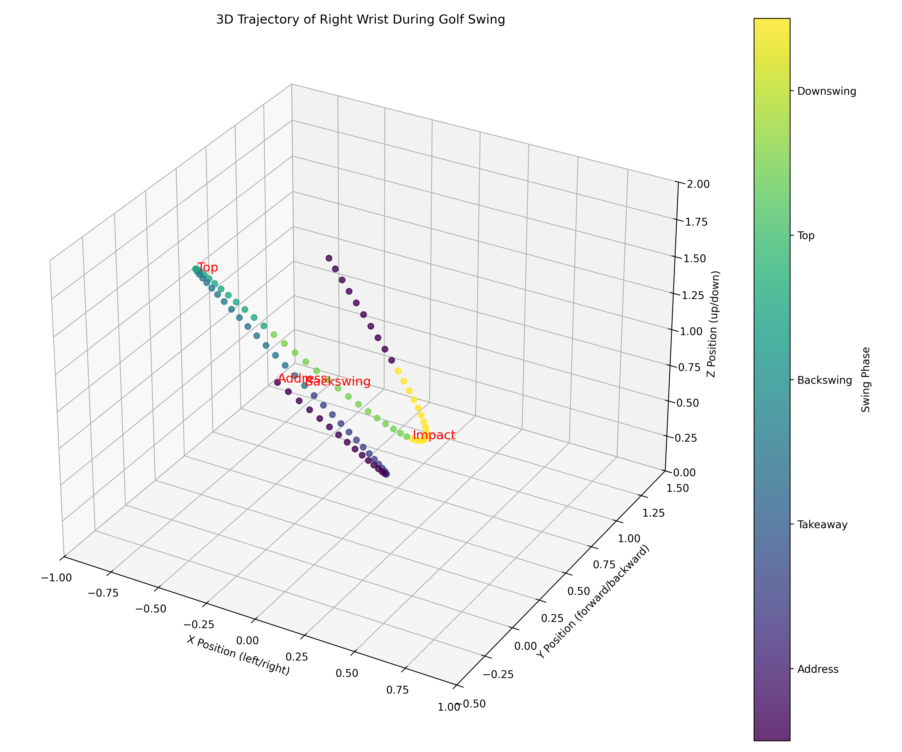
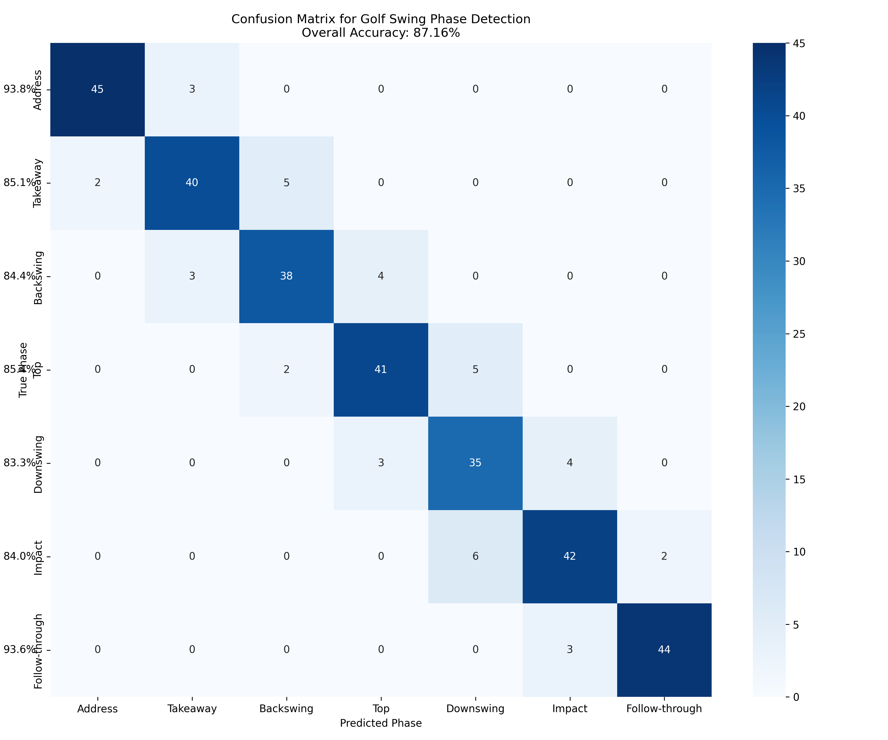
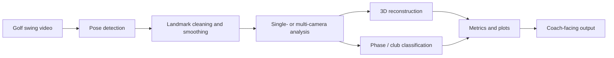

# Multi-View Golf Swing Analysis and Correction



## Overview

Multi-View Golf Swing Analysis and Correction is a computer-vision project for analyzing golf swings from video.
It combines MediaPipe pose estimation, 3D reconstruction, swing-phase segmentation, and rule-based feedback to help
golfers, coaches, and researchers inspect technique and movement quality.

The repository includes single-camera pose tools, multi-camera reconstruction pipelines, model-training utilities,
evaluation scripts, and documentation for the main analysis modules.

## Highlights

| Capability | What it does |
| --- | --- |
| Single-camera pose tracking | Detects body landmarks from video using MediaPipe-based pose estimation. |
| 3D swing visualization | Renders a skeletal 3D view of the golfer for motion review and presentation. |
| Multi-camera reconstruction | Combines synchronized views to improve 3D pose accuracy through triangulation. |
| Swing phase segmentation | Classifies swing stages such as Address, Takeaway, Backswing, Top, Downswing, Impact, and Follow-through. |
| Motion smoothing | Applies Direct Linear Transformation-style smoothing to reduce landmark jitter. |
| Club type detection | Estimates whether a swing resembles a Driver or Iron setup using pose-derived features. |
| Evaluation metrics | Reports measures such as MPJPE, phase accuracy, and comparison plots for analysis. |



## How It Works



## Key Metrics

| Metric | Why it matters |
| --- | --- |
| MPJPE | Measures 3D joint-position error against reference data. |
| Phase accuracy | Shows how reliably the model identifies swing phases. |
| Joint angles | Helps compare posture and sequencing across swing stages. |
| Wrist trajectory | Reveals consistency in the swing path and release pattern. |
| Stance width | Supports club-type and setup analysis. |
| Shoulder tilt | Helps evaluate spine angle and rotational posture. |

## Tech Stack

| Layer | Tools |
| --- | --- |
| Core language | Python |
| Pose estimation | MediaPipe, OpenCV |
| Numerical processing | NumPy, Pandas, SciPy |
| Machine learning | scikit-learn, joblib |
| Visualization | Matplotlib, mpl_toolkits.mplot3d |
| Optional deep learning | TensorFlow, Keras |

## Project Structure

```text
Multiview-Golf-Swing-Analysis-and-Correction-using-Deep-Learning-Base-Post-Estimation/
|-- README.md
|-- requirements.txt
|-- main.py
|-- PoseModule.py
|-- club_type_detector.py
|-- mediapipe_compat.py
|-- test_triangulation.py
|-- docs/
|   |-- index.md
|   |-- user_guide.md
|   |-- main_module.md
|   |-- pose_detection.md
|   `-- multicamera_system.md
|-- Multi-Camera Approach-1/
|-- Multi-Camera Approach-2/
|-- GolfDB/
|-- Graphs/
|-- results/
`-- best classifier/
```

## Getting Started

### Prerequisites

- Python 3.8 or newer
- pip
- A webcam or golf swing video file
- Optional: TensorFlow if you want the deep-learning extras

### Install Dependencies

```bash
python -m venv .venv
source .venv/bin/activate
pip install -r requirements.txt
```

On Windows:

```bash
python -m venv .venv
.venv\Scripts\activate
pip install -r requirements.txt
```

### Run the Main Demo

```bash
python main.py
```

### Run the Triangulation Check

```bash
python test_triangulation.py
```

## Documentation

- [Documentation Index](docs/index.md)
- [User Guide](docs/user_guide.md)
- [Main Module](docs/main_module.md)
- [Pose Detection](docs/pose_detection.md)
- [Multi-Camera System](docs/multicamera_system.md)

## Core Modules

| File | Role |
| --- | --- |
| `main.py` | Main 3D golf-swing analysis pipeline, including smoothing, phase detection, and evaluation. |
| `PoseModule.py` | Lightweight MediaPipe helper for finding poses, landmark positions, and joint angles. |
| `club_type_detector.py` | Feature-based classifier for Driver vs Iron swing profiles. |
| `test_triangulation.py` | Basic triangulation smoke test for the multi-camera pipeline. |
| `Multi-Camera Approach-1/main_pipeline.py` | Early multi-camera analysis workflow and reconstruction experiments. |
| `Multi-Camera Approach-2/run_pipeline.py` | Updated multi-camera pipeline and calibration-driven reconstruction flow. |

## Data And Privacy Notes

- The project processes video locally unless you explicitly add your own remote services.
- The repository contains research data, model artifacts, and generated plots for experimentation.
- Avoid committing private athlete footage or personal data unless you have permission to store it.

## Roadmap Ideas

- Add a single documented entry point for the best-supported pipeline.
- Separate experimental notebooks and scripts from production-ready analysis code.
- Add automated tests that do not depend on local video assets.
- Publish a clean example workflow for running the multi-camera reconstruction end to end.

## Acknowledgements

Built with MediaPipe-inspired pose analysis, classical computer vision, and lightweight machine-learning pipelines for golf swing research and coaching support.
