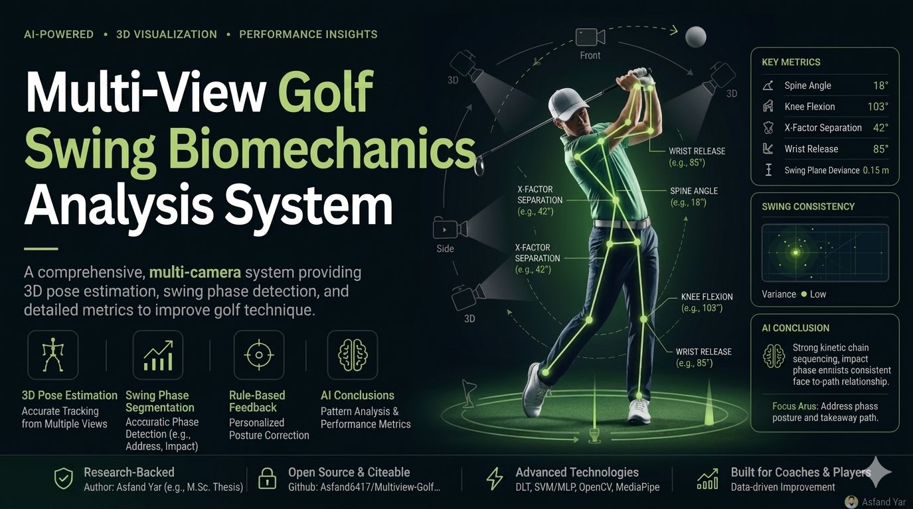
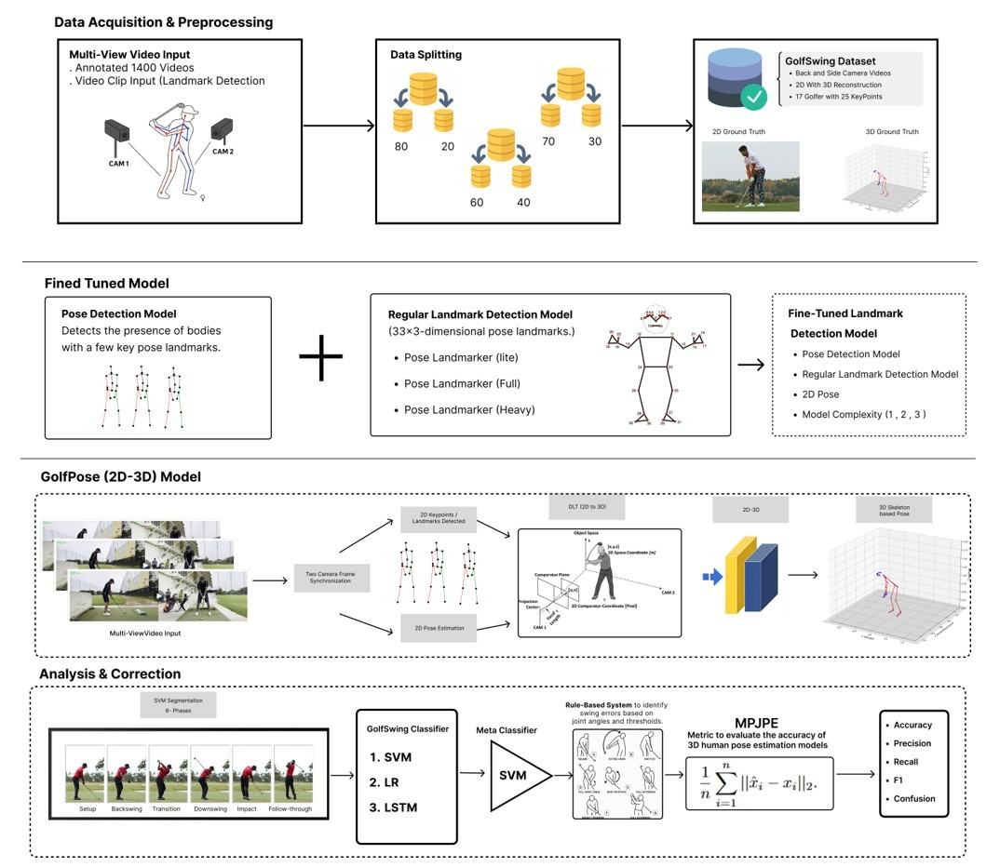
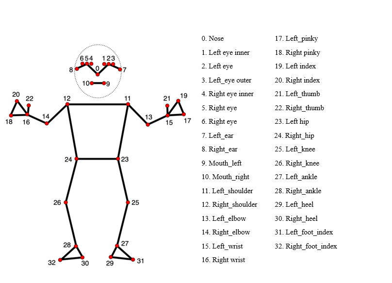
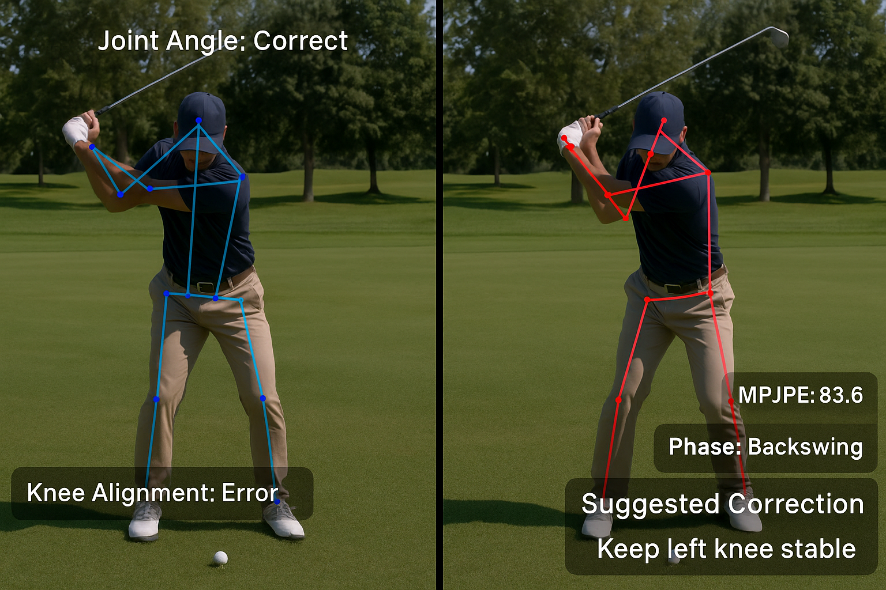

<div align="center">

  <h1>Pro Swing AI — Golf Swing Biomechanics Intelligence</h1>

  <p>
    An AI-assisted golf swing laboratory for multi-view 3D reconstruction,
    biomechanics analysis, swing-phase segmentation, and automated coaching feedback.
  </p>

  <p>
    <a href="https://github.com/Asfand6417/Multiview-Golf-Swing-Analysis-and-Correction-using-Deep-Learning-Base-Post-Estimation">GitHub Repository</a>
    |
    <a href="./docs/index.md">Documentation Index</a>
    |
    <a href="./docs/user_guide.md">User Guide</a>
  </p>

  <p>
    
    
    
    
    
  </p>

</div>



Overview
--------
Pro Swing AI (Golf) is a research-grade, product-oriented platform that converts synchronized multi-view swing video into accurate 3D biomechanics, actionable coaching feedback, and reproducible performance metrics. The product bridges laboratory-grade motion-capture capability and practical consumer camera workflows by combining robust computer vision, geometry, and machine learning.

Key capabilities
----------------
- Multi-view pose estimation and synchronized video ingestion
- Markerless motion capture using MediaPipe Pose
- DLT-based 3D triangulation and reconstruction
- Swing phase segmentation and kinematic feature extraction
- Rule-based fault detection with coaching suggestions
- MPJPE and related reconstruction quality reporting
- Interactive 3D visualizations and annotated playback
- Local-first design: video processing can run on-device or on-premises

Highlights
----------
| Capability | Description |
|------------|-------------|
| Multi-view biomechanics | Uses synchronized side and down-the-line camera views for robust 3D reconstruction |
| Markerless motion capture | Tracks motion using MediaPipe Pose without markers or wearables |
| DLT reconstruction | Triangulates 2D landmarks to produce accurate 3D joint coordinates |
| Swing phase segmentation | Automatically detects 8 swing phases for context-aware analysis |
| Biomechanics analysis | Computes X-Factor, spine angle, hip/shoulder rotation, wrist trajectory, and joint kinematics |
| Fault detection engine | Identifies common swing faults and provides corrective coaching feedback |
| Performance reporting | MPJPE reports, confusion matrices, and classification metrics |
| 3D visualization | Interactive skeletal playback and trajectory rendering |

Research results
----------------
| Metric | Result |
|--------|--------|
| Overall MPJPE | 8.77 mm |
| Setup MPJPE | 7.21 mm |
| Backswing MPJPE | 7.85 mm |
| Transition MPJPE | 9.53 mm |
| Downswing MPJPE | 10.76 mm |
| Impact MPJPE | 9.24 mm |
| Follow-through MPJPE | 8.03 mm |
| Expert Coaching Agreement | 85.3% |
| Processing Speed | 18.2 FPS |
| Pose Landmarks | 33 Keypoints |

System architecture
-------------------


Illustrations
-------------
<p align="center">
  
</p>
<p align="center"><em>DLT 3D Tracking of Golfer's Swing — triangulated joint cloud and reconstructed skeleton used for biomechanical feature extraction and visualization.</em></p>

<p align="center">
  
</p>
<p align="center"><em>MediaPipe Pose landmark topology — 33 body keypoints used as the base 2D detections that feed DLT triangulation and biomechanical metrics.</em></p>

Flow (high level):
- Dual Camera Golf Swing Videos → Frame Synchronization → MediaPipe Pose Estimation → Keypoint Validation → DLT Triangulation → 3D Reconstruction → Trajectory Smoothing → Feature Engineering → Swing Phase Classification → Rule-Based Error Detection → Coaching Feedback → Annotated Reports & Visualizations

How it works
------------
1. Multi-view video input (synchronized frames).
2. 2D pose detection per frame using MediaPipe; filtering by confidence.
3. DLT triangulation using calibrated camera matrices to recover 3D joint positions.
4. Smoothing (e.g., Savitzky–Golay) and temporal feature extraction.
5. Feature-based or learned phase segmentation (SVM / neural models).
6. Rule-based and learned fault detection (early extension, loss of spine angle, etc.).
7. Generate metrics, visual overlays, and coach-facing recommendations.

Swing phases
-------------
The system classifies each frame into one of eight phases:
1. Address
2. Takeaway
3. Backswing
4. Top
5. Transition
6. Downswing
7. Impact
8. Follow-through

Biomechanical metrics
---------------------
Measured and reported metrics include (non-exhaustive):
- MPJPE (3D reconstruction error)
- X-Factor (hip-to-shoulder separation)
- Hip / Shoulder rotation
- Spine angle and trunk mechanics
- Knee flexion and joint velocities
- Wrist trajectory and swing plane consistency
- Lead arm extension and impact geometry
- Performance and repeatability statistics

Fault detection
---------------
The expert-rule engine identifies common faults, including:
- Early Extension
- Over-the-Top swing path
- Loss of Spine Angle
- Insufficient Hip Rotation
- Reduced X-Factor
- Lead Arm Collapse
- Improper Knee Flexion
- Excessive Lateral Sway



Each detected fault includes an explanation and corrective recommendation.

Technology stack
----------------
| Layer | Technology |
|-------|------------|
| Language | Python 3.10+ |
| Pose Estimation | MediaPipe Pose |
| Computer Vision | OpenCV |
| Numerical | NumPy, SciPy, Pandas |
| ML & DL | Scikit-Learn, PyTorch / TensorFlow optional |
| Reconstruction | Direct Linear Transformation (DLT) |
| Visualization | Matplotlib, Web-based 3D viewer |
| Backend API | FastAPI |
| Frontend | Next.js, TailwindCSS |
| Storage | PostgreSQL (optional) |
| Deployment | Docker, GPU-enabled inference nodes |

Project layout
--------------
```
Multiview-Golf-Swing-Analysis/
├── README.md
├── requirements.txt
├── src/
│   ├── analysis/
│   │   ├── main.py
│   │   ├── PoseModule.py
│   │   ├── club_type_detector.py
│   │   ├── mediapipe_compat.py
│   │   └── test_triangulation.py
│   └── utils/
│       ├── video_processing.py
│       ├── display_info.py
│       ├── folder_management.py
│       ├── golf_rules.py
│       └── mpjpe_calculation.py
├── backend/
├── frontend/
├── data/
├── docs/
├── experiments/
├── assets/
├── images/
└── reports/
```

Installation
------------
1. Clone repository
```bash
git clone https://github.com/Asfand6417/Multiview-Golf-Swing-Analysis-and-Correction-using-Deep-Learning-Base-Post-Estimation.git
cd Multiview-Golf-Swing-Analysis-and-Correction-using-Deep-Learning-Base-Post-Estimation
```

2. Create virtual environment
```bash
python -m venv .venv
source .venv/bin/activate  # macOS / Linux
# or
.venv\Scripts\activate     # Windows
```

3. Install Python dependencies
```bash
pip install -r requirements.txt
```

4. Start API (example)
```bash
python src/analysis/main.py
```

5. Frontend
- Navigate to `frontend/` and run the Next.js app (`npm install` then `npm run dev`) — see frontend README for details.

Usage
-----
- Run the main analysis pipeline:
```bash
python src/analysis/main.py
```
- Validate triangulation:
```bash
python src/analysis/test_triangulation.py
```
- Run experimental multi-camera pipelines:
```bash
python experiments/multi_camera/approach_2/run_pipeline.py
```

Core modules
------------
| Module | Purpose |
|--------|---------|
| `src/analysis/main.py` | Main pipeline entry |
| `src/analysis/PoseModule.py` | MediaPipe wrapper and joint calc |
| `src/analysis/test_triangulation.py` | DLT validation |
| `src/analysis/club_type_detector.py` | Club classifier |
| `src/analysis/*` | Supporting modules for preprocessing, smoothing, and metrics |

Data & privacy
--------------
- Processing can run locally; athlete footage remains under user control.
- Store reports locally or on-premises Postgres.
- Do not publish footage without consent.

Roadmap
-------
- Real-time coaching and mobile support
- Transformer-based swing understanding
- Automated camera calibration
- Club and shaft-plane analysis
- Cloud analytics and benchmarking

Scientific citation
-------------------
```bibtex
@article{yar2026golfswing,
  title={Multi-View Golf Swing Analysis and Correction Using Markerless 3D Biomechanics},
  author={Yar, Asfand and others},
  journal={Scientific Reports},
  year={2026}
}
```

Acknowledgements
----------------
Built using MediaPipe, OpenCV, DLT, and modern sports biomechanics research to transform raw golf swing video into actionable coaching intelligence.


